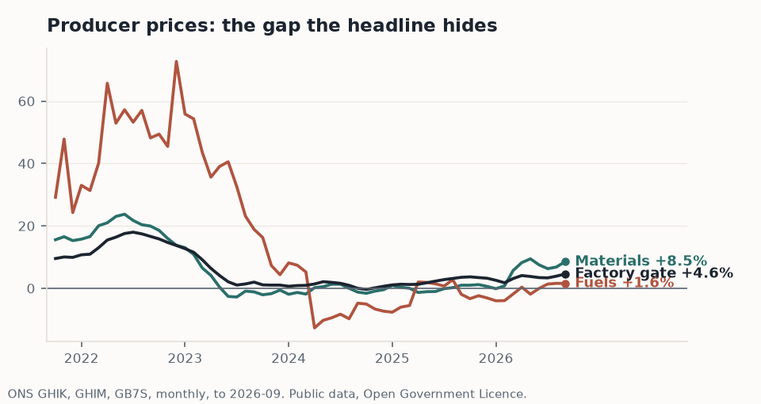

# UK macro chartbook

A designed one-page macro readout from public series: ONS with no API key,
plus an optional FRED row. One script, one HTML page, and the individual
chart tiles as PNGs.



## Why it exists

Most macro reporting is either a dashboard nobody reads or a chart pasted
without its provenance. This is the third thing: a chartbook designed to be
read in one pass, where every chart carries its source, series ID and data
vintage in the footer. A chart that cannot say where it came from is an
opinion with axes.

The outputs are committed deliberately, so the repo shows its product, not
just its code.

## Run it

```
python3 -m venv .venv && .venv/bin/pip install matplotlib
.venv/bin/python chartbook.py
```

Open `outputs/chartbook.html`. Set `FRED_API_KEY` (free from fred.stlouisfed.org)
and three more tiles appear: Brent, US CPI, GBP/USD. Without it the ONS
charts are unaffected.

## The tiles

| Tile | Series | The question it answers |
|---|---|---|
| Consumer prices | D7BT | What is headline inflation, computed from the index rather than quoted |
| Producer price gap | GHIK, GHIM, GB7S | Are input costs and factory gate prices telling the same story |
| Pay against prices | K54U, D7BT | Is the real-wage squeeze unwinding |
| Steel pair | GHGJ, EW6T | One sector's inputs against its own factory gate |
| Food pair | GHEF, EVOQ | The other cost world, same economy |
| Unemployment | MGSX | The labour market behind the earnings line |

All ONS series fetched from the undated timeseries endpoints (the dated ones
can serve frozen editions silently); annual changes computed from index
levels, not quoted rates.

## Method

Every number in the battery comes from the same chain, starting at the
published index level. Worked through on steel factory gate prices (EW6T):

**1. Index.** ONS publishes the level each month. EW6T stood at 178.2 in
September 2025 and 206.7 in September 2026.

**2. Annual change (YoY).** This month against the same month a year ago:

```
YoY = I(t) / I(t-12) - 1  =  206.7 / 178.2 - 1  =  +16.0%
```

**3. Rolling 12M.** The average of the last twelve index levels against the
average of the twelve before. Smooth, but slow: every month in the window
counts equally, however old.

**4. Wtd-R12.** The last twelve YoY readings, weighted linearly toward the
most recent month. Weights are i/78 for i = 1 (oldest) to 12 (newest),
because 1+2+...+12 = 78. In percent, oldest to newest:

```
1.3  2.6  3.8  5.1  6.4  7.7  9.0  10.3  11.5  12.8  14.1  15.4
```

The newest month carries 15.4% of the reading; the oldest 1.3%. On steel,
the last twelve YoY readings run from -8.6% to +17.7%. Equal weights net
that out to +1.1%; recency weighting gives +6.1%. When the two diverge this
much, the series has turned, and the plain average has not noticed yet.

**Wtd-R3.** The same idea over three months: weights 1, 2, 3 of 6, so the
latest month carries half the reading. Fast but noisy; read it against
Wtd-R12.

**The table.** One row per series, every lens on it: latest and prior
month's annual change, Wtd-R3, unweighted rolling 12M, Wtd-R12, a Wtd-R12
forward projection, and CAGR over two, three and five years. Sample from
the November 2026 run:

| Series | Latest | Prior | Wtd-R3 | Rolling 12M | Wtd-R12 | Wtd-R12 fwd | CAGR 2yr | CAGR 3yr | CAGR 5yr |
|---|---|---|---|---|---|---|---|---|---|
| Consumer prices (CPI) | +3.4% | +3.1% | +3.2% | +3.1% | +3.0% | +3.5% | +3.6% | +3.0% | +5.1% |
| Materials inputs | +8.5% | +6.8% | +7.6% | +4.7% | +6.2% | +7.4% | +4.7% | +2.7% | +5.1% |
| Steel factory gate | +16.0% | +14.1% | +15.7% | +1.1% | +6.1% | +11.6% | +3.2% | +1.3% | -1.8% |

Wtd-R12 fwd is a projection, not a forecast: the next twelve months'
average against the last twelve IF the index keeps moving at the Wtd-R12
pace. The assumption is stated because the number is only as good as it.
A real forecast carries a backtest - see the motorcycle repo for what that
looks like.

**5. CAGR.** The index compounded over n years:

```
CAGR = ( I(t) / I(t - 12n) ) ^ (1/n) - 1
```

Five windows, one index, and they can legitimately disagree. That is not a
flaw in the data. It is why the window you quote should always be stated.

## Design rules

Direct end-labels with the latest value, never a legend box. A zero line on
every rate chart. One palette, shared with [the portfolio site]
(https://sdouglas8787.github.io), so public output reads as one body of work.
Source, series ID and vintage on every tile, without exception.

## Licence and attribution

ONS data under the Open Government Licence v3.0. FRED data per the FRED
terms of use where shown.
